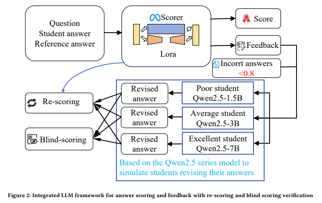
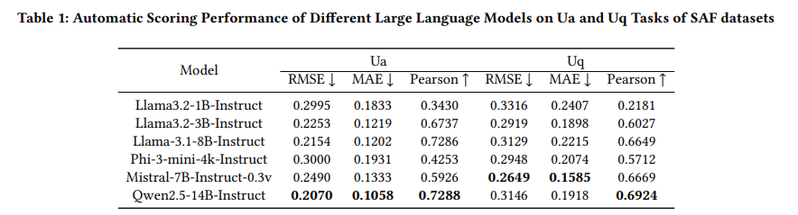
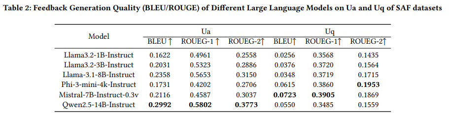
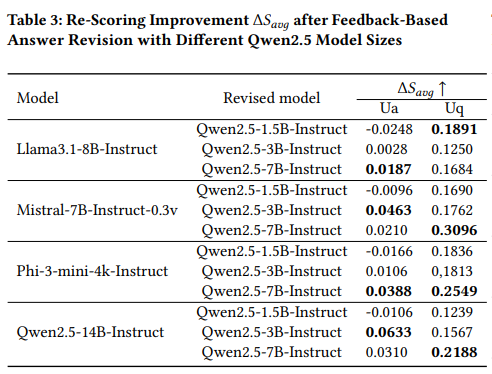
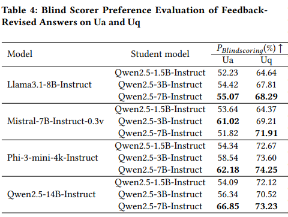

# Scoring_Feedback_Verification
## Improving from Feedback: An integrated LLM Framework for Answer Scoring and Feedback with Blind Scoring and Rescoring Verification

With the proliferation of large-scale online learning platforms and
Web-based assessment tools, AI-powered scoring systems have
become crucial for scaling education. However, most existing Webdeployed systems merely output scores and feedback, lack an understanding of the critical process by which students learn through feedback. This paper addresses this limitation by proposing an integrated "scoring, feedback, revision, re-scoring, and blind scoring,"
which implements a comprehensive process from initial scoring to
learning improvement and objective verification. The framework
first receives the question, the student’s answer, and the reference
answers. A large language model fine-tuned with LoRA generates
initial scores and feedback. Subsequently, Qwen2.5 models of varying sizes simulate students in three categories: poor, average, and
excellent. Based on the feedback, multiple revised answers are generated and re-scored by the same scoring model to quantify the
gains from the feedback. Independent blind grading also objectively
evaluates the revised answers without prior knowledge to verify
the credibility of the re-grading results. This framework not only
provides a final evaluation score, but also simulates and evaluates
the effectiveness of the interactive process of "teaching feedbackstudent learning," laying the foundation for building more reliable
and adaptable online intelligent tutoring systems.

  

## Environment
conda create -n LLMScoring python=3.10

conda activate LLMScoring

pip install -r requirements.txt

## Datasets Download
SAFDataset: https://huggingface.co/datasets/Short-Answer-Feedback/saf_communication_networks_english

## Preparation
-Create a folder named output, which stores the training model weights, scoring and feedback results.

-Create three folders named Qwen2.5-1.5B-Instruct, Qwen2.5-3B-Instruct, and Qwen2.5-7B-Instruct to store the revised answers.

-Create two folders named rescore and blindscore to output rescore and blind score respectively.

## Step 1: Lora Fine-tuning model, scoring and feedback
python lora_scoring.py --model_path base_models/Qwen2.5-14B-Instruct

## Step 2: Revising answer
python revising_answer.py --model_path base_models/Qwen2.5-7B-Instruct --feedback_path output/Qwen2.5-14B-Instruct_scoring_ua_results.json

## step 3: Re-scoring 
python rescoring.py --model_path output1/Qwen2.5-14B-Instruct_final_checkpoint  --improve_answer_path Qwen2.5-7B-Instruct//Qwen2.5-14B-Instruct_scoring_uq_results_improve_answer.json
    
## step 4: Blind scoring
python blind_scoring.py --model_path base_models/gpt-oss-120b  --improve_answer_path Qwen2.5-7B-Instruct//Qwen2.5-14B-Instruct_scoring_uq_results_improve_answer.json

## Scoring Results

  

## Feedback Results

  

## Re-scoring Results

  

## Blind Scoring Results

  

